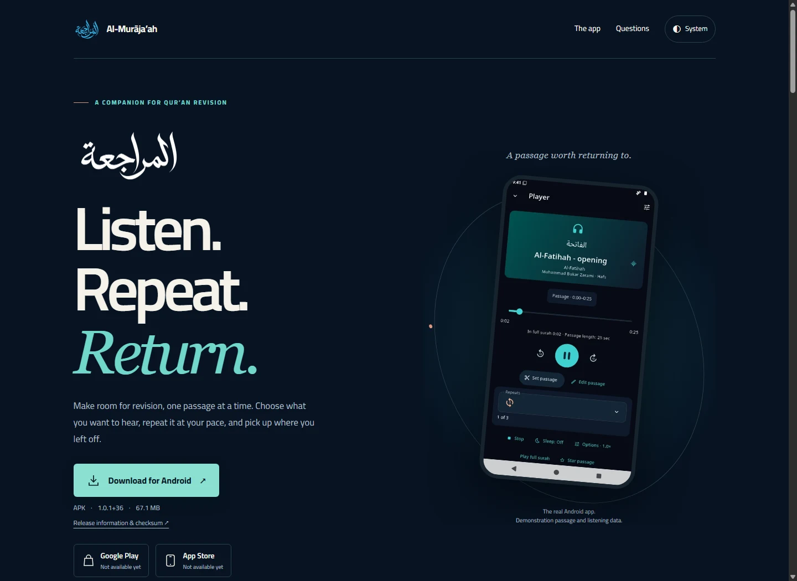
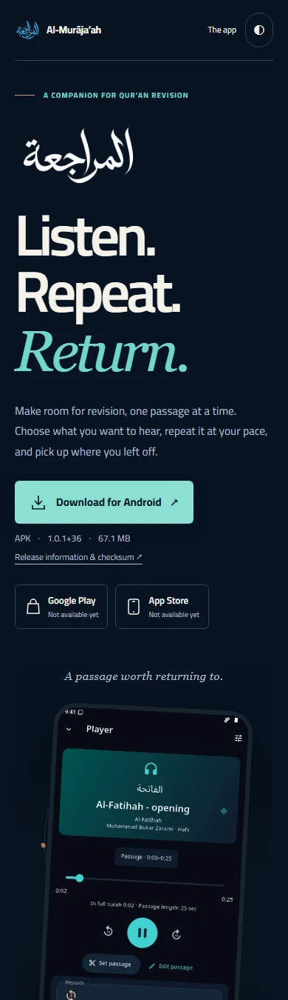

<p align="center">
  <a href="https://al-murajaah.devs.surf/"></a>
</p>
<h1 align="center">Al-Murāja’ah</h1>
<p align="center">A small, static home for a Qur’an revision companion.<br>Explore the Android app, then download it directly.</p>
<p align="center"><strong><a href="https://al-murajaah.devs.surf/">Visit the website ↗</a></strong></p>
<p align="center">
  <a href="https://github.com/S-Adnan-11/al-murajaah/releases/download/v1.0.1/Al-Muraja.ah.apk">Android APK</a> ·
  <a href="https://github.com/S-Adnan-11/al-murajaah/releases/tag/v1.0.1">Release &amp; checksum</a> ·
  <a href="https://github.com/S-Adnan-11/al-murajaah">Mobile app source</a> ·
  <a href="https://github.com/S-Adnan-11/al-murajaah-feedback/issues">Feedback</a>
</p>
<p align="center">
  <a href="https://developer.mozilla.org/en-US/docs/Web/HTML"></a>
  <a href="https://developer.mozilla.org/en-US/docs/Web/CSS"></a>
  <a href="https://developer.mozilla.org/en-US/docs/Web/JavaScript"></a>
  <a href="https://nodejs.org/"></a>
  <a href="https://pages.cloudflare.com/"></a>
</p>

This repository contains the download and showcase website for **Al-Murāja’ah (المراجعة)**. The app’s player, recordings and local library live in the [separate mobile project](https://github.com/S-Adnan-11/al-murajaah). The website runs on plain HTML, CSS and JavaScript, hosted on Cloudflare Pages through its GitHub integration.

[Features](#features) · [Preview](#preview-and-validation) · [Structure](#directory-map) · [Release updates](#updating-the-download) · [Contributing](#contributing)

## A look around



*Desktop, 1440px viewport. Captured from the live website in Chrome.*

<p align="center"></p>

*Mobile, 390px viewport. Chrome device emulation; not a physical-device capture.*

## Features

- Direct Android APK download, with version, size and release information visible before clicking.
- A responsive walkthrough of choosing, repeating and saving passages, offline listening, background playback and listening progress.
- The app’s English/Arabic reminder, with manual language selection, a pause control and a 6.5-second readable dwell.
- System-aware light/dark styling, bundled Cairo typography and motion that pauses offscreen or when the tab is hidden.
- Reduced-motion support, keyboard controls and useful content without JavaScript.
- Clear store availability, installation help, privacy information and asset credits. No analytics, advertising cookies, service worker or automatic audio.

## Technology

| Technology | Role |
| --- | --- |
| HTML | Initial content, bilingual copy, metadata and structured data. |
| CSS | Responsive layout, themes, typography and restrained animation. |
| JavaScript | Theme choice, reminder timing and accessible store-status messages. |
| Node.js 22+ | Development-only preview, validation and release-metadata scripts using built-in modules. |
| Cloudflare Pages | Static hosting, HTTPS and production deployments from GitHub’s main branch. |

There is no application server, bundler, framework or runtime package dependency. Flutter belongs to the Android app, not this website.

## Preview and validation

```sh
git clone https://github.com/S-Adnan-11/al-murajaah-web.git
cd al-murajaah-web
node tools/serve.mjs
```

Open **http://127.0.0.1:4173/**. No install or build step is required. In another terminal:

```sh
node tools/check.mjs
node --check dist/app.js
```

The checks cover release consistency, local assets, JSON-LD, canonical naming, icon dimensions, sitemap URLs and browser-runtime boundaries. Also review narrow layouts, both themes, keyboard focus, Arabic text, reduced motion and no-JavaScript behavior. Browser emulation does not replace physical Android, Safari, Firefox or assistive-technology testing.

See [HOSTING.md](HOSTING.md) for Pages settings, production checks and Search Console live-test instructions. Search appearance and indexing are not guaranteed by metadata or a sitemap.

## Directory map

```text
dist/                   Static document root
  index.html            Homepage and initial metadata
  notices.html          Credits page, served at /notices
  404.html              Branded missing-page response
  styles.css, app.js    Presentation and small browser interactions
  assets/               Project artwork, app screenshots, icons and licensed font
  robots.txt            Crawl policy and production sitemap reference
  sitemap.xml           Canonical public pages
docs/screenshots/       Website captures used in this README
tools/                  Node preview, checks and release-update scripts
release.json            Verified Android download metadata
asset-provenance.json   Asset sources, transformations and capture provenance
HOSTING.md              Hosting and search-maintenance guidance
LICENSE                 First-party website code licence
```

## Updating the download

1. Verify the actual Android release asset URL, version/build, byte size and SHA-256 against the GitHub release. Follow redirects with a HEAD request; do not infer size from an older APK.
2. Update the related values together in `release.json`, including `verifiedAt` and the decimal MB size label. Do not put the APK in this repository.
3. Run `node tools/release.mjs`, then the validation commands above. Review the direct anchor, visible version/size, release fallback and application JSON-LD. Update the Android links in this README when the release changes.
4. Keep screenshot captions tied to the build actually captured. Replace images when needed and update `asset-provenance.json`; changing the download does not make old screenshots newer.

The download remains a normal anchor to GitHub. Browser/device settings may show a prompt; clicking does not establish that a download finished. Recording downloads are separate from the APK.

## Contributing

Open an [issue](https://github.com/S-Adnan-11/al-murajaah-web/issues) or a focused pull request here for website improvements. For app behavior or recording issues, use the [feedback tracker](https://github.com/S-Adnan-11/al-murajaah-feedback/issues). Explain the change, run the checks and include screenshots for visible changes. Keep the static runtime small and preserve language, accessibility and download behavior.

Never include credentials, diagnostic logs, personal data, signing material, APKs or private recovery documents. Production changes to main deploy automatically through Pages, so check the final diff and deployed responses. Preserve any existing Search Console verification file, meta tag or DNS record.

## Licensing and assets

First-party website code is [MIT licensed](LICENSE), © 2026 S. Adnan. Project calligraphy, wordmarks, icons and app/website screenshots have separate asset-use boundaries; their presence here does not grant a general artwork redistribution licence. Cairo is bundled unmodified with its [SIL Open Font License](dist/assets/Cairo-OFL.txt). See the [credits page](https://al-murajaah.devs.surf/notices) and [asset provenance](asset-provenance.json) before reusing assets. No recitation audio is hosted in this repository.
