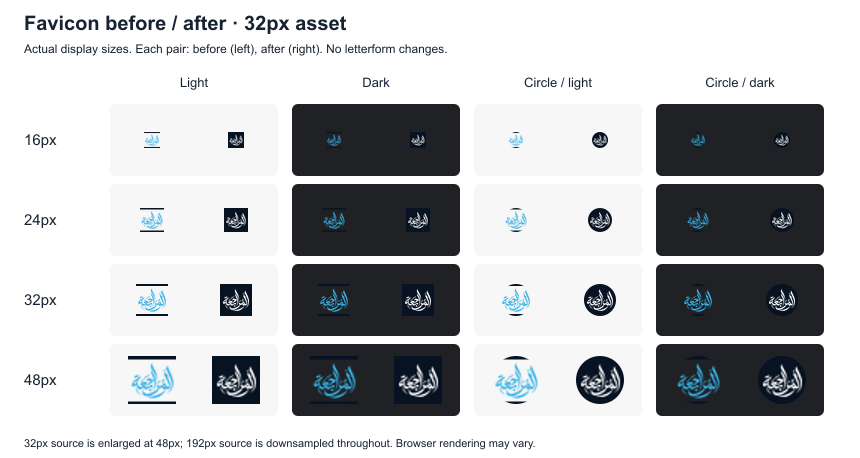

# Favicon artwork — 24 October 2026

The original 32px and 192px PNGs are retained in `before/` for comparison. Both contain transparent areas, blue calligraphy and opaque navy padding bars. On dark backgrounds the blue loses contrast, and a circular crop leaves too little room around the mark.

The revision uses the approved original `assets/brand/4.0x/main-blue.png` from the mobile project, copied here as `main-blue.png` (512×443; SHA-256 `90cc509317cf0ec1be96fc08a8084549090992cc0ee044ec484434c940d169ee`). This is the same source identified for the website calligraphy in `asset-provenance.json`.

The generator retains its exact alpha silhouette, crops only transparent margins, recolours it white, scales it uniformly and centres it on opaque `#071322`. The original letterforms and proportions are preserved within raster rounding. There is no new lettering, redraw, outline, artificial boldening or generated artwork. Solid white/navy contrast is 18.66:1; antialiased edge pixels naturally have lower contrast. The favicon remains intricate at 16px.

The mark fits within 80% of the canvas (rounded to whole pixels). At 32px the mark is 26×22px; at 192px it is 154×131px. Visible mark pixels (alpha >16/255) clear the circular boundary by at least 2.34px and 16.10px respectively. The navy square fills the presentation circle; the calligraphy is not cut to a circle in the source asset.

All four existing icon sizes (32, 180, 192, 512) use this treatment, keeping their existing URLs and HTML declarations. Website calligraphy, sharing image, website design and download behaviour are unchanged. Output SHA-256 hashes are recorded in `asset-provenance.json`.

## Before / after at actual display sizes

Each pair is **before on the left, after on the right**. The four columns show light and dark surfaces, then circular crops on both surfaces. Rows are 16, 24, 32 and 48px. View at 100% for native pixels; fit-to-window resizing changes their apparent size. These are deterministic raster previews, not Google Search screenshots. Browser resampling may vary.




The 32px source is enlarged in the 48px row. The 192px source is downsampled for every row. This shows the two actual source assets separately rather than assuming their rendering is interchangeable.

## Reproduce

From the repository root, using Node.js and development-only tooling:

```sh
npm install --prefix .preview/tooling --no-save --package-lock=false --ignore-scripts sharp@0.35.5
node tools/favicon.mjs
node tools/check.mjs
```

The script writes the four existing PNGs and these two preview sheets; original before assets are never overwritten. It checks circular clearance and prints dimensions and contrast. Sharp is outside the deployed `dist/` directory and is not a website runtime dependency. The original source and before assets retain the project's existing artwork-use restrictions.
